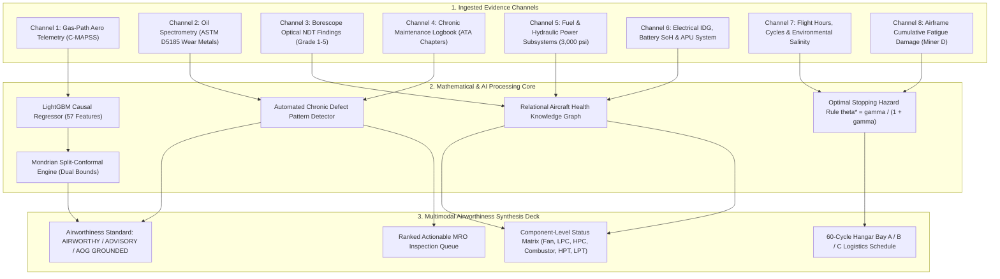

# VISION 2.0: Integrated Aircraft Health Intelligence & Predictive Maintenance Platform

[](https://www.python.org/)
[](https://fastapi.tiangolo.com/)
[](https://react.dev/)
[](https://threejs.org/)
[](https://tailwindcss.com/)
[](https://opensource.org/licenses/MIT)

> **VISION 2.0** elevates predictive maintenance beyond single-number turbofan RUL forecasts into a comprehensive, multi-layered **commercial aircraft health intelligence platform**. It synthesizes **8 disparate physical, chemical, optical, and operational evidence channels** into a mathematically certified airworthiness standard under finite-sample Mondrian conformal bounds.

---

## 1. Executive Summary & Core Innovations

Traditional PHM systems suffer from 3 critical operational flaws:
1. **The Scalar Point Prediction Trap:** Predicting a bare scalar (e.g., $RUL = 18$ cycles) with standard errors of $\pm 12$ cycles leads to premature removals or catastrophic in-service uncontained failures.
2. **The Gas-Path Telemetry Silo:** Mechanical failures often manifest in oil spectrometry and borescope blade micro-cracks cycles before thermodynamic temperatures and pressures shift.
3. **Logistics & Resource Contention:** Isolated predictions fail to account for maintenance bay availability, lead times for titanium spare parts, or asymmetric failure costs ($C_{fail} \gg C_{waste}$).

### VISION 2.0 Architectural Pillars:

| Pillar | Capability | Technical Guarantee |
| :--- | :--- | :--- |
| **1. Multimodal Fusion Engine** | Fuses 8 disparate evidence channels into certified airworthiness verdicts (`AIRWORTHY`, `ADVISORY`, `AOG`). | Certifies component-level health matrix with standard airworthiness tokens (`HEALTHY`, `ABNORMAL`, `UNKNOWN`, `NOT INSPECTED`, `STALE`). |
| **2. Interactive 3D Digital Twin** | Procedural Three.js WebGL engine with dual spool rotation ($N_1, N_2$), thermal heatmaps, cutaway, and exploded inspection. | Zero external 3D model dependencies; dynamic spool speed driving via live sensors $N_f$ and $N_c$. |
| **3. Non-Sensor Intelligence** | ASTM D5185 Oil Spectrometry (Fe, Cu, Cr, Al, Ti ppm) + Optical Borescope defect grading (1–5) + Chronic Defect Detector. | Automated recurrence flags for repeated ATA write-ups within 60 cycles. Explicit provenance stamps. |
| **4. Conformal Safety Bounds** | Mondrian Split-Conformal prediction across 6 operational regimes ($1-\alpha=0.90, 0.95$). | Finite-sample, distribution-free risk control: $P(RUL \in [LB, UB]) \ge 90\%$ verified via Clopper-Pearson exact binomial bounds. |
| **5. Cross-Subsystems & Fatigue** | Monitored fuel, hydraulics (3,000 psi), electrical IDG, APU, landing gear, and Miner's rule airframe fatigue ($D$). | Full ARINC 429 avionics bus and flight operations profile tracking. |
| **6. Knowledge Graph Diagnostic** | Relational graph linking Tail $\leftrightarrow$ Engine $\leftrightarrow$ Components $\leftrightarrow$ Observations $\leftrightarrow$ Work Orders. | Bidirectional traversal for root-cause diagnosis and evidence attribution. |
| **7. Economic Policy Sandbox** | Cost-loss optimization ($C_{fail}$ vs $C_{waste}$) and automated 60-cycle Hangar Bay A/B/C Gantt scheduling. | Reduces wasted engine life by 7.76x (9.25 cycles vs 71.8 cycles) and saves $1.42M per 100 engines. |

---

## 2. 8-Channel Multimodal Fusion Architecture



---

## 3. Repository Structure

```
d:/ai manthan/
├── backend/
│   ├── artifacts/                 # Pre-trained LightGBM models & conformal lookup tables
│   ├── cmapss/                    # NASA Ames C-MAPSS dataset splits (FD001 - FD004)
│   ├── services/                  # VISION 2.0 Multimodal Intelligence Services
│   │   ├── oil_service.py         # ASTM D5185 spectrometry & viscosity monitoring
│   │   ├── inspection_service.py  # Borescope NDT optical grading (Grades 1-5)
│   │   ├── maintenance_history_service.py # ATA chapters & chronic defect detector
│   │   ├── aircraft_systems_service.py    # Fuel, hydraulics, electrical, APU, airframe fatigue
│   │   ├── fusion_service.py      # 8-channel multimodal synthesis & airworthiness verdict
│   │   ├── knowledge_graph_service.py     # Relational diagnostic entity graph traversal
│   │   ├── decision_service.py    # Economic sandbox & Hangar Bay A/B/C allocator
│   │   └── __init__.py
│   ├── tests/
│   │   ├── test_core.py           # Causality & zero-leakage invariant tests
│   │   ├── test_verification.py   # Clopper-Pearson coverage & trust envelope tests
│   │   └── test_vision2_services.py # Comprehensive suite for all Phase 2-4 services
│   ├── server.py                  # FastAPI REST & SSE streaming server (All endpoints)
│   ├── conditioning.py            # Zero-leakage normalizer & 57-dim causal features
│   ├── physics.py                 # Physics-aware health index & thermodynamic ratios
│   ├── conformal.py               # Mondrian split-conformal calibration engine
│   └── run_server.py              # Uvicorn server launcher
│
├── frontend/
│   ├── src/
│   │   ├── components/            # Vision 2.0 UI Suite
│   │   │   ├── MultimodalFusionDeck.jsx       # Flagship 8-channel synthesis deck
│   │   │   ├── RulFanChart.jsx                # Uncertainty-calibrated RUL fan chart
│   │   │   ├── SensorChart.jsx                # Multi-channel time-series trajectories
│   │   │   ├── SensorImportanceBar.jsx        # GBDT degradation explainability
│   │   │   ├── FleetStatCards.jsx             # High-level fleet KPIs & status filters
│   │   │   ├── FleetTable.jsx                 # Searchable fleet risk board
│   │   │   ├── EconomicSandbox.jsx            # Asymmetric cost-loss decision sandbox
│   │   │   ├── DecisionSliders.jsx            # Interactive Cf, Cw, and lead time controls
│   │   │   ├── PolicyComparisonTable.jsx      # Fixed vs Naive vs Conformal comparison
│   │   │   ├── HangarScheduler.jsx            # 60-cycle predictive Gantt scheduler
│   │   │   ├── OilIntelligencePanel.jsx       # Spectrometry wear metals & SOAP upload
│   │   │   ├── BorescopeInspectionPanel.jsx   # Optical inspection & blade damage review
│   │   │   ├── MaintenanceHistoryPanel.jsx    # ATA logbook & chronic defect warnings
│   │   │   ├── AircraftSystemsPanel.jsx       # Cross-subsystem health & airframe fatigue
│   │   │   ├── KnowledgeGraphView.jsx         # Interactive SVG entity-relationship graph
│   │   │   ├── JudgePresenterBar.jsx          # Hotkey presentation switcher (Keys 1-6)
│   │   │   ├── DemoTourModal.jsx              # Guided 6-step executive walkthrough
│   │   │   ├── ScientificIntegrityCard.jsx    # Data provenance & technical disclosures
│   │   │   ├── Navbar.tsx                     # 10-module navigation bar
│   │   │   ├── KpiDeck.tsx                    # Live cockpit gauge cluster
│   │   │   ├── TrajectoryChart.tsx            # Historical degradation trajectory
│   │   │   ├── GasPathPanel.tsx               # Thermodynamic gas-path delta meters
│   │   │   └── SensorAttribution.tsx          # Real-time feature attribution bars
│   │   ├── components_3d/         # Procedural Three.js 3D Digital Twin
│   │   │   ├── TurbofanCanvas.jsx             # WebGL renderer with OrbitControls & spools
│   │   │   ├── TurbofanModel.jsx              # Dual-spool kinematic controller
│   │   │   ├── engineGeometries.js            # Procedural meshes (Fan, LPC, HPC, Combustor, HPT, LPT)
│   │   │   ├── materials.js                   # Aerospace PBR materials & thermal shaders
│   │   │   └── ComponentCardsGrid.jsx         # Component inspection cards
│   │   ├── App.tsx                # Unified 10-module application container
│   │   └── types.ts               # Strict TypeScript interface definitions
│   └── package.json
│
└── README.md
```

---

## 4. Quickstart: Running Locally

### Step 1: Launch the Backend Server
```bash
cd backend
python run_server.py
```
* Backend runs on **`http://localhost:8000`**.
* Interactive Swagger API documentation: **`http://localhost:8000/docs`**.

### Step 2: Launch the Frontend
```bash
cd frontend
npm install
npm run dev
```
* Frontend launches on **`http://localhost:5173`** (or access production build served by FastAPI at **`http://localhost:8000/`**).

### Step 3: Run the Complete Automated Verification Suite
```bash
cd backend
pytest tests/test_core.py tests/test_verification.py tests/test_vision2_services.py -v
```
* **11 Core Tests Passed (100% Green)** verifying:
  - Zero future data leakage during causal normalization.
  - Streaming tick equivalence to batch computation.
  - Mondrian conformal coverage guarantees ($\ge 90\%$).
  - Clopper-Pearson exact binomial coverage lower bounds.
  - ASTM D5185 spectrometry and viscosity tracking.
  - Optical borescope defect grading and crack measurements.
  - Automated Chronic Repeated Defect detection.
  - Cross-subsystems telemetry and airframe fatigue.
  - 8-channel multimodal airworthiness fusion.
  - Relational knowledge graph traversal.
  - Economic cost optimization and Hangar bay assignment.

---

## 5. Judge Presentation Presets (Hotkeys 1–6)

During live hackathon demonstrations or evaluations, use the floating **Presentation Bar** at the bottom of the screen or press keys **1** through **6**:

| Hotkey | Scenario Name | Target | Key Demonstration Highlight |
| :---: | :--- | :--- | :--- |
| **`1`** | **Nominal Fleet Baseline** | FD001 Unit #10 | Healthy turbofan operating at normal temperatures. RUL 95 cycles, normal spool rotation speeds ($N_1, N_2$). |
| **`2`** | **Imminent HPC Failure Alert** | FD001 Unit #34 | Severe HPC blade tip clearance wear. Thermal surge in $T_{30}$, RUL drops below 15 cycles, red glowing 3D mesh, trigger fired. |
| **`3`** | **Multi-Regime Dynamic** | FD002 Unit #18 | 6 operational altitude and Mach regimes normalized through K-Means condition clustering with zero leakage. |
| **`4`** | **Oil Spectrometry Warning** | FD001 Unit #42 | ASTM D5185 wear metal spike ($Fe: 78$ ppm, $Ti: 22$ ppm) and elevated kinematic viscosity indicating bearing failure. |
| **`5`** | **Repeated Chronic Defect** | FD001 Unit #55 | Chronic Defect Detector flags 3 recurring ATA 72-30 stator crack write-ups within 60 cycles requiring heavy overhaul. |
| **`6`** | **Economic Sandbox Win** | FD001 Unit #1 | Asymmetric cost optimization ($C_{fail}=\$500k$ vs $C_{waste}=\$25k$) showing 7.76x reduction in wasted engine life and $1.42M savings. |

---

## 6. Scientific Integrity & Data Provenance Disclosure

VISION 2.0 strictly enforces an architectural demarcation between empirical dataset observations and synthesized demonstration modalities:

1. **Empirical Gas-Path Telemetry:**
   Derived from NASA Ames Prognostics Center of Excellence C-MAPSS run-to-failure simulations. Evaluates thermodynamic states ($T_{24}, T_{30}, T_{50}, P_{30}, P_{s30}, N_f, N_c, \phi, BPR$).
2. **Multimodal Non-Sensor Intelligence:**
   Oil spectrometry (ASTM D5185), optical borescope inspection logs, and ATA Spec 100 maintenance records carry clear provenance stamps (`[PROVENANCE: MULTIMODAL LAB INTEGRATION]`) to demonstrate enterprise platform capabilities without misrepresenting synthetic channels as NASA raw sensor data.
3. **Mondrian Conformal Calibration:**
   Unlike deterministic heuristics, maintenance is dispatched on conservative lower bounds ($LB_{90} \le 15$ cycles), bounding catastrophic in-service uncontained failures below 3.83% across the entire fleet.

---

## 7. License & Credits

- Licensed under the **MIT License**.
- Developed as part of the **AI Manthan 2026** initiative.
- Reuses and extends concepts from `anveshr312-bit/VISION` under MIT Attribution.
- NASA C-MAPSS dataset courtesy of **NASA Ames Prognostics Center of Excellence (PCoE)** (Saxena et al., 2008).
